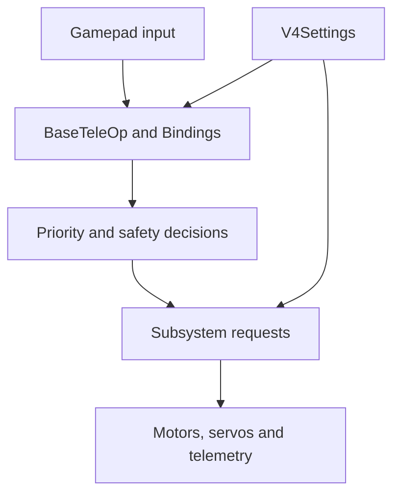

# GoBuilda V5 — System Architecture

The core design is **separate control decisions from hardware behavior**. TeleOp decides *what the driver requests*; subsystems implement *how the motors and servos respond*.

## Main components

| Component | Main responsibility |
|---|---|
| `teleop/BaseTeleOp.java` | Single- vs. two-driver layouts, actions, hold/press/toggle behavior, priorities, telemetry |
| `teleop/Binding.java` | Converts button input into HOLD, PRESS and TOGGLE semantics |
| `config/V4Settings.java` | Central hardware, accessory, shooter and navigation settings (historical filename retained in V5) |
| `subsystems/` | Drives mechanism outputs and handles mechanism states and safeguards |
| `navigation/FieldLibrary.java` | Red-authored field destinations and starting poses |
| `Constants_GoBuilda.java` | Pedro/Pinpoint motor and localization configuration |
| `autonomous/` | Routines, starting poses, ordered paths and mechanism actions |
| `commands/MechanismCommands.java` | Ivy commands used by autonomous mechanisms |

## Control flow

## Driving and navigation

Manual mecanum drive and BASIC navigation both use the robot's motion/localization model. BASIC runs a straight-line path with heading interpolation to a configured named destination; it is **not** obstacle-aware. Moving the sticks cancels it. Pinpoint or Auto ending pose feeds the current pose; standalone TeleOp can seed a named fallback. INIT tells the driver whether it is using `AUTO HANDOFF` or `FALLBACK: <pose>`.

## Shooter, intake and feeder

- Intake and side rollers operate together; controls request forward/reverse and subsystem code applies direction.
- Shooter commands use selected RPM presets plus temporary controller trim.
- The feeder waits for **initial** shooter readiness. When pause-and-recover is enabled, speed loss can pause feeding until recovery is stable.
- Feeder-only reverse wins over forward feed; full reverse has a deliberate 500 ms hold and overrides competing requests.
- On reverse release, forward and firing requests may need to be issued again.

## Autonomous

The Java Auto declares its actual start, constructs paths with Pedro, and schedules actions with Ivy. `sequential(...)` orders them; `parallel(...)` overlaps independent actions. The routine can invoke `MechanismCommands` for shooter/feed operations rather than duplicating mechanism implementation. The tutorial includes a park-only starter and a shoot-and-park extension.

## How to add a basic feature

1. Find a free binding in `BaseTeleOp.java` for the relevant layout.
2. Decide HOLD / PRESS / TOGGLE, stop-on-release behavior, and conflicts.
3. Read the request in the relevant handler each loop.
4. Call an existing subsystem method, or add one small method there.
5. Ensure STOP and higher-priority safety requests still stop the motor/servo.
6. Test press, hold, release, conflicts and STOP, then update the Controls Guide.

The tutorial demonstrates the pattern with a second intake button and a held shooter-reverse action. Those are **examples to implement**, not controls already enabled in the stock V5 mapping.

## Important limitations

- This document follows the supplied V5 tutorial; inspect the full Java source for exact class methods, initialization, priorities and current defaults.
- A named field pose is safe to use only after physical measurement and testing.
- One driver layout's button map must not be substituted for the other.
